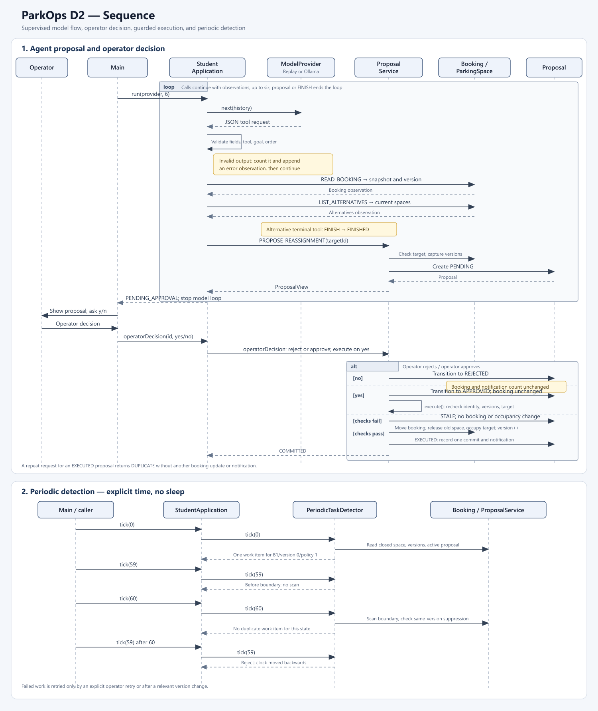
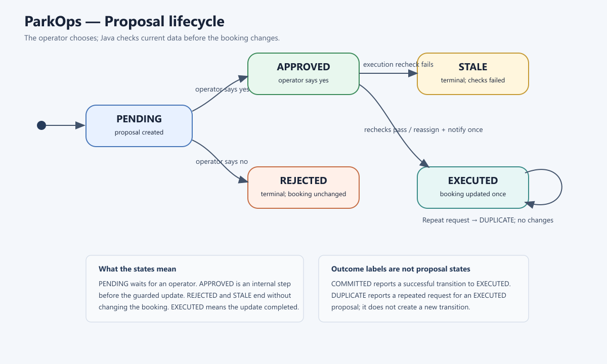
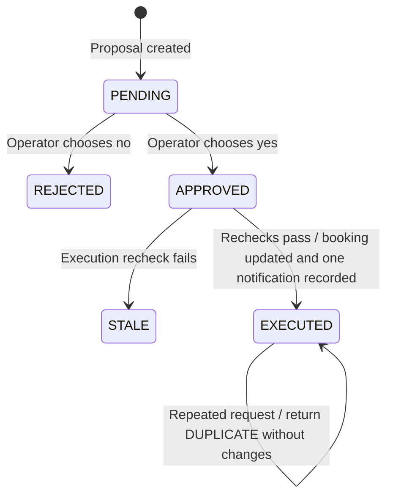

D1.5 Explainations

////Responsibilities
Booking
    - Holds the Id of the booking, id of the space, integer duration for the booking length, whether the booking needs accessibility, and saves it's requests version for validity checks
   
    * Methods
        Booking() - accesses the domain rules to assert naming constraints, and valid duration hours
        Snapshot() - Provides and immutable mapping/dicitonary of the bookings values
        (Supplied Getters and setters) for read only actions
        
Parking Space
    - Privately owns the id of the space, info regarding the space whether it's an accesibility type, and the state of occupacy/- avilability

    * Methods
        ParkingSpace() - Constructor, asserts the correct naming scheme for space id, and initializes the final values
        Snapshot() - Provides and immutable mapping/dicitonary of the parking spaces values.
        (Supplied Getters and setters) for read only actions.
        IsAvailable() - returns a derived boolean making use of whether the space is open and not occupied


Proposal
    - A class that is used to "propose" requests of a speicied booking.
    - Supporting funcitons like returning the state of a proposed booking, created within the proposal service

    * Methods
        Proposal() - Constructor that initilizes a final, unchanging state of the requested proposal
        View() - provides a proposal view of the data stored within the proposal
        (Supplied Getters and setters) for read only actions.

Proposal Service
    - Owns proposal creation and the proposal lifecycle in the context of application use.
    - Creates unique proposals, records operator approval or rejection, and executes only approved proposals.
    - Rechecks booking and policy versions plus target eligibility before controlled domain mutation.

    * Methods
        ProposalService() - Constructuor - Recieves
        Propose() - Creates a pending proposal after validating that a booking space change is possible.


Student Application
    - Coordinates model calls, validated tool dispatch, proposal actions, and periodic detection.
    
    * Methods
        BookingSnapshot() allows the caller to view the status of the booking as Read Only
        Propose() - Talks to the proposal service to provide a valid proposal view.


Restrictions

Proposal service, restricted in the context of this D1 is hardcoded to a single booking, where as in a proper application should be able to process several bookings for varries proposals

Operation Contracts
    StudentApplication.propose(targetId)
    - Precondition: the target id is valid under domain rules, and isn't the same target of the booking
    - Postcondition: It returns a pending proposal for booking the, it also keeps track of booking policy version
    - Frame condition: It does not change the booking. If the target is invalid or ineligible, it rejects the request and still leaves the booking unchanged.
    
    StudentApplication.bookingSnapshot()
    - NO Precondition 
    - Postcondition: returns an immutable snapshot of the booking
    - Frame condition: Calling it does not change the booking.

Important Current Limitation

## D2.4 — Updated workflow diagrams and design choices

The diagrams below describe the current Java implementation. `ModelProvider` is supplied either by `ReplayProvider` for deterministic replay or `OllamaProvider` for a model-connected run. Both use the same application loop.

Rendered figures (PNG) with editable SVG sources:

- [Sequence diagram PNG](diagrams/d2-sequence.png) · [SVG source](diagrams/d2-sequence.svg)
- [Proposal state diagram PNG](diagrams/d2-proposal-state.png) · [SVG source](diagrams/d2-proposal-state.svg)





### Agent, proposal, and operator sequence

```mermaid
sequenceDiagram
    autonumber
    actor Operator
    participant Main
    participant App as StudentApplication
    participant Provider as ModelProvider
    participant Booking
    participant Spaces as ParkingSpace list
    participant Service as ProposalService
    participant Proposal

    Operator->>Main: Start agent run
    Main->>App: run(provider, 6)
    loop Each model call, up to six
        App->>Provider: next(history)
        Provider-->>App: JSON tool request
        App->>App: Parse and validate fields, tool, goal, and order
        alt Invalid or unknown request
            App->>App: Count invalid output and append error observation
        else READ_BOOKING
            App->>Booking: snapshot()
            Booking-->>App: Booking data and version
            App->>App: Append observation to history
        else LIST_ALTERNATIVES
            App->>Spaces: Read current spaces
            Spaces-->>App: Space snapshots
            App->>App: Append observation to history
        else PROPOSE_REASSIGNMENT after read and list
            App->>Service: propose(targetId)
            Service->>Spaces: Check target eligibility
            Service->>Booking: Read current booking version
            Service->>Proposal: Create PENDING proposal
            Service-->>App: Proposal view
            App-->>Main: PENDING_APPROVAL result; stop model loop
        else FINISH
            App-->>Main: FINISHED; stop model loop
        end
    end
    Main-->>Operator: Show proposal and ask y/n
    Operator->>Main: Enter decision
    Main->>App: operatorDecision(proposalId, decision)
    alt Operator rejects
        App->>Service: reject(proposalId)
        Service->>Proposal: Transition to REJECTED
        Service-->>App: REJECTED
        Note over Booking: Booking and spaces remain unchanged
    else Operator approves
        App->>Service: approve(proposalId)
        Service->>Proposal: Transition to APPROVED
        Service-->>App: APPROVED; booking unchanged
        App->>Service: execute(proposalId)
        Service->>Service: Recheck proposal identity, booking version, policy version, and target eligibility
        alt A check fails
            Service->>Proposal: Transition to STALE
            Service-->>App: STALE or UNAVAILABLE_OR_INELIGIBLE
            Note over Booking: Booking and spaces remain unchanged by failed execution
        else Checks pass
            Service->>Booking: Move booking; increment version
            Service->>Spaces: Release old space; occupy target
            Service->>Proposal: Transition to EXECUTED
            Service->>Service: Record one commit and one notification
            Service-->>App: COMMITTED
        end
    end
    opt Same executed proposal is submitted again
        Main->>App: operatorDecision(sameProposalId, decision)
        App->>Service: execute(sameProposalId)
        Service-->>App: DUPLICATE; no additional mutation or notification
    end
```

### Periodic detection sequence

```mermaid
sequenceDiagram
    autonumber
    participant Main
    participant App as StudentApplication
    participant Detector as PeriodicTaskDetector
    participant Booking
    participant Service as ProposalService

    loop Explicit ticks at 0, 59, and 60 seconds
        Main->>App: tick(timeSeconds)
        App->>Detector: tick(timeSeconds)
        alt First tick or 60-second boundary
            Detector->>Booking: Read assigned space and booking version
            Detector->>Service: Check for active or prior proposal at this version
            alt Assigned space is closed and work is not suppressed
                Detector-->>App: One PeriodicWorkItem
            else No affected booking, active proposal, or prior attempt
                Detector-->>App: Empty work list
            end
        else Before next boundary
            Detector-->>App: No scan; empty work list
        end
        App-->>Main: PeriodicTickResult
    end
    Main->>App: tick(earlier time)
    App->>Detector: tick(backwards time)
    Detector-->>App: Reject clock moved backwards
```

### Proposal state diagram



`REJECTED`, `STALE`, and `EXECUTED` are terminal proposal states. `DUPLICATE` is an outcome for a repeated request, not a new proposal state. The service returns `COMMITTED` for the successful transition to `EXECUTED`.

### Significant design choices and alternatives

1. **Provider boundary:** `ModelProvider` lets the same runner use deterministic replay or the Ollama HTTP adapter. Putting HTTP calls directly in `StudentApplication` would tie application coordination to one provider and make local deterministic replay less convenient.
2. **Explicit periodic ticks:** `PeriodicTaskDetector.tick(timeSeconds)` makes the 0/59/60 boundary and backwards-clock behavior controllable in the single-process assignment. A background scheduler would add asynchronous timing and coordination that are not needed for these requirements.
